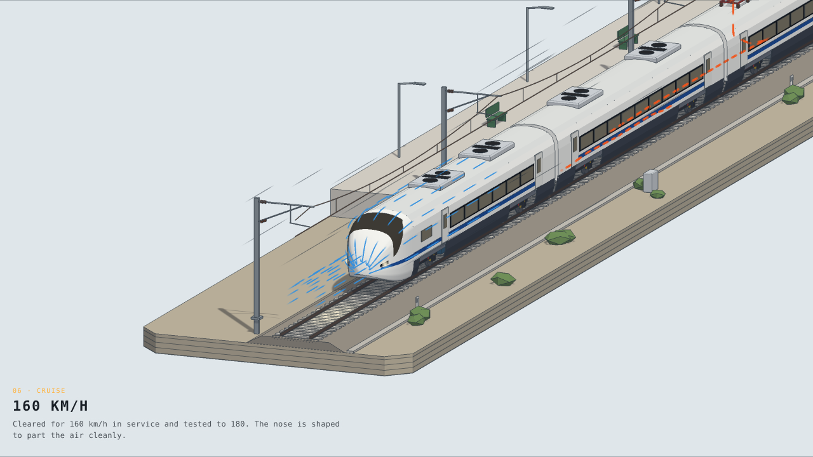
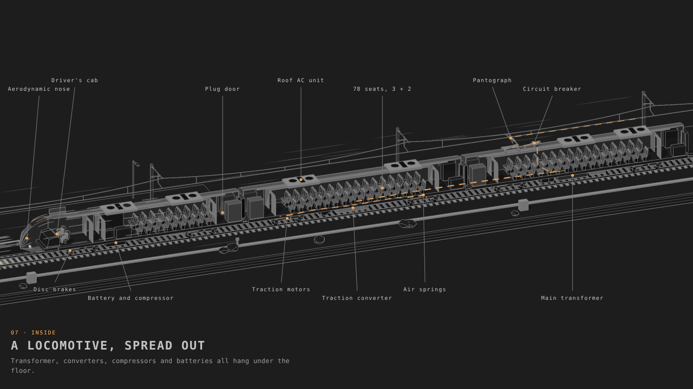
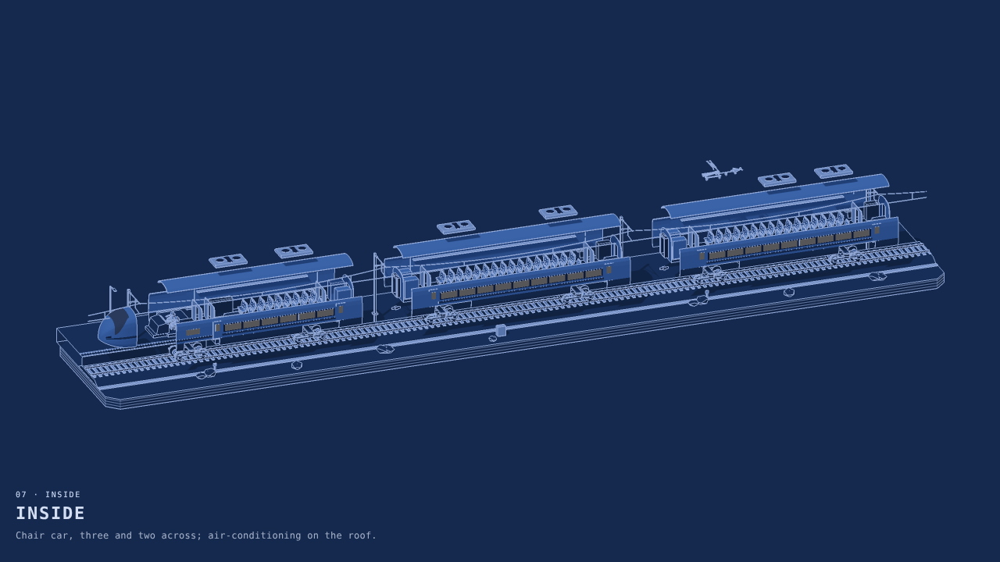
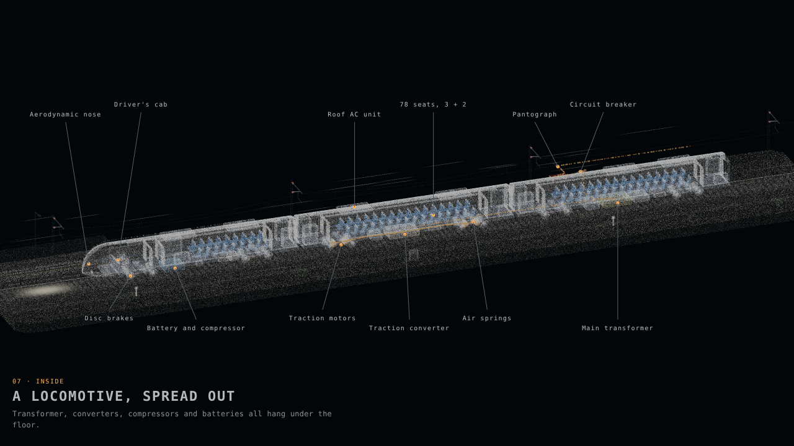
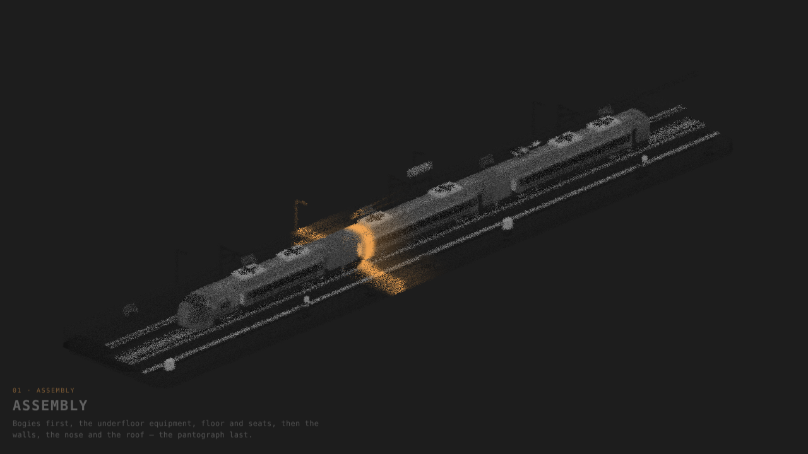

# Vande Bharat Figure

An interactive 3D figure of a Vande Bharat trainset that runs in the browser: one script, no build step for users, no dependencies to install.

**Live demos: [solid](https://nikitph.github.io/vande-bharat-figure/) · [point cloud](https://nikitph.github.io/vande-bharat-figure/points.html)**



It shows three cars of the sixteen — the driving trailer with its nose and cab, a motor coach, and a trailer coach carrying the pantograph — on a stretch of track with a platform and overhead line. A ten-chapter film takes the train from a pile of parts to 160 km/h and back.

| Cutaway with callouts (Dark theme) | Exploded view (Blueprint theme) |
| --- | --- |
|  |  |

## Also here: Panipat 1526

The same engine and drawing style applied to a historical battle, with animated armies of soldiers, horsemen and elephants: [diorama](https://nikitph.github.io/vande-bharat-figure/panipat/) · [point cloud](https://nikitph.github.io/vande-bharat-figure/panipat/points.html). Source and notes are in [`panipat/`](panipat/).

## Point-cloud mode

Set `render="points"` and every surface is resampled into dots (about three million at the default density) that glow on black like an X-ray, with the film, views and options unchanged. Silhouettes are brightened in place of ink lines, the light adds up where surfaces overlap, and the livery colours carry through. Dots can do things lines and solid faces cannot, so this mode adds:

- **Condensing assembly**: parts drift in as loose clouds and settle into shape, while a scan line sweeps the length of the train.
- **Ghosted cutaway**: instead of cutting the near shell away, it thins to a few percent of its dots, so you see inside without losing the outline.
- **Particle flows**: air streams past the nose and current runs from the wire to the motors as moving particles, reversing under regenerative braking.
- **See-through density**: the gaps between dots let seats and equipment show faintly through the body even with the cutaway off.
- **Heat**: traction motors, the converter and the transformer glow with load (in both modes).

| Cutaway with callouts | Regenerative braking |
| --- | --- |
|  |  |

`density` scales the point count (0.5 is about a million points; the demo uses that on narrow screens) and `pointSize` scales the dots. Changing `density` resamples, which takes a moment.

## What it does

- **Film** in ten chapters: assembly, at the platform, power up, doors close, departure, cruise, inside, regenerative braking, arrival, shutdown.
- **Views**: cutaway, exploded, labels, airflow over the nose, and the power path from the contact wire to the traction motors (it reverses under regenerative braking).
- **Inspect**: point at any part to read what it is.
- **Toggles**: doors, pantograph, headlights, cabin lights.
- **Six themes** (Dark, Paper, Light, Blueprint, Sepia, Colour) and two liveries (blue and white, saffron).
- **Camera**: drag to turn, scroll to zoom, shift-drag to slide along the train, double-click to return to the film camera.

## Use it

Copy `vande-bharat.js` next to your page and add the element:

```html
<script src="vande-bharat.js"></script>
<vande-bharat-figure theme="colour" captions style="width:100%;height:520px"></vande-bharat-figure>
```

Every option is also an attribute (lower-cased) and can be changed later:

```js
const el = document.querySelector("vande-bharat-figure");
el.set({ cutaway: true, labels: true, livery: "saffron" });
el.phase(5);          // jump to chapter 6, "Cruise"
el.toggle("panto");   // raise or lower the pantograph
el.addEventListener("chapter", e => console.log(e.detail.name));
```

Or drive it directly, with callbacks:

```js
const figure = MFVB.createVandeBharat(hostElement, { theme: "dark" }, {
  onChapter: i => {}, onFrame: (state, status) => {}, onInspect: part => {}
});
figure.set({ explode: true });
figure.seek(12.5);    // seconds into the film
figure.dispose();
```

### Options

| Option | Default | What it does |
| --- | --- | --- |
| `render` | `solid` | `solid` or `points` |
| `density`, `pointSize` | `1`, `1` | Point count and dot size in point-cloud mode |
| `theme` | `dark` | `dark`, `paper`, `light`, `blueprint`, `sepia`, `colour` |
| `livery` | `blue` | `blue` or `saffron`; visible in the `colour` theme |
| `play`, `speed`, `start` | `true`, `1`, `0` | Run the film, its rate, and the chapter to start on (0–9) |
| `filmCamera` | `true` | Let the film move the camera; off for a free camera |
| `azimuth`, `elevation`, `zoom`, `focusX` | `318`, `26`, `1`, `0` | Free-camera position |
| `cutaway`, `explode`, `labels`, `inspect` | `false` | Views |
| `airflow`, `power` | `true` | Show airflow lines and the power path when the film calls for them |
| `captions` | `false` | Chapter captions over the figure |
| `filmCutaway`, `filmLabels` | `true` | Let the "Inside" chapter open the cutaway and labels by itself |
| `ground`, `platform` | `true` | Show the track bed and the platform |
| `drag`, `wheelZoom` | `true` | Pointer controls |
| `sunFrom`, `sunHeight`, `shadowSoftness`, `ambient`, `lineWidth` | | Lighting and ink-line weight |

Every colour is an option too: the theme colours (`bg`, `ink`, `glow`, …) and one paint per material (`body`, `stripe`, `seat`, `motor`, `ballast`, …). `MFVB.PAINT_GROUPS` lists them all with labels. `MFVB.CHAPTERS`, `MFVB.THEMES`, `MFVB.TOGGLES` and `MFVB.PARTS` expose the rest.

## Accuracy

This is an explanatory model, not a scale drawing.

- The geometry is modelled by hand from general dimensions: cars about 24 m long and 3.2 m wide, 915 mm wheels, 1,676 mm gauge.
- Figures in the captions (0–100 km/h in about 52 s, 78 seats in a chair car, tested to 180 km/h) were written from memory and have not been checked against a source.
- Placing the pantograph on the trailer coach beside the transformer is an assumption about the formation.

Corrections are welcome.

## Develop

```
src/01-core.js    helpers, shared uniforms, two-tone materials
src/02-train.js   cars, bogies, nose, pantograph, power path, airflow
src/03-stage.js   track, platform, overhead line
src/04-film.js    chapters, timeline, themes, paints, defaults
src/06-points.js  surface sampling and particle streams for point-cloud mode
src/05-main.js    renderer, camera, input, overlay, the custom element
vendor/           three.js r184, pre-bundled
build.py          concatenates vendor + src into vande-bharat.js
```

Run `python3 build.py`, then open `index.html` or `points.html` from any static server. The source files are plain scripts that share one closure with the vendored three.js, where it is available as `F`.

## Credits

Rendering uses [three.js](https://threejs.org) (MIT licence, © three.js authors), bundled in `vendor/`. The drawing style — two-tone shading with ink outlines, the chapter film and the option names — follows an existing F-35B figure that this project was adapted from; a few small helper functions from that bundle remain in the vendored prefix.
