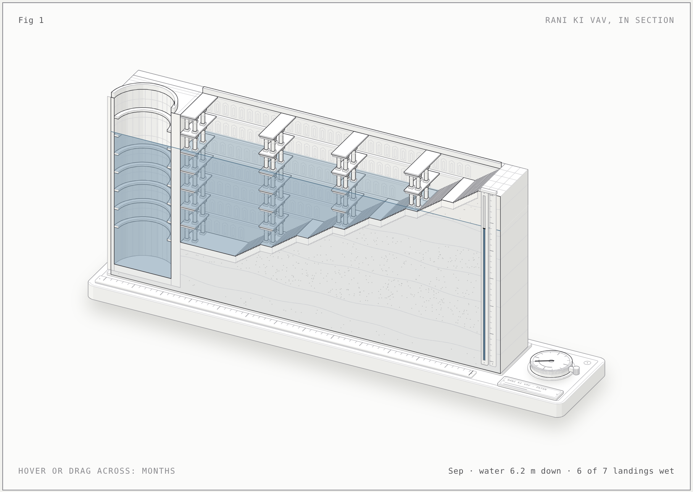

# Figures

Precision isometric figures in the "anatomy" style: a real, well-made object whose working *is* the explanation, drawn as SVG solids in a fixed isometric camera, with every number shown coming from the same model that moves the parts.

| Figure | What moves | Live |
| --- | --- | --- |
| [Rani ki Vav, in section](rani-ki-vav/) | The water table, month by month | [light](https://nikitph.github.io/vande-bharat-figure/figures/rani-ki-vav/) · [dark](https://nikitph.github.io/vande-bharat-figure/figures/rani-ki-vav/rani-ki-vav.html) |



## Rani ki Vav, in section

A sectional museum model of the eleventh-century stepwell at Patan (c. 1063 CE), cut down its east–west axis and standing on a bench.

- **Built dimensions** from published surveys: about 65 m long; seven flights of stairs (112 risers here) falling 23 m to a 9.5 × 9.4 m kund; a well shaft 10 m across and 30 m deep; three pillared pavilion towers whose storeys grow toward the well, plus galleries on the kund's west wall.
- **The mechanism:** a month dial sets the water table. Water rises in the shaft, floods the kund and climbs the stairs terrace by terrace; the earth's section darkens below the same level, and a sight glass on the section reads the depth in metres. The monthly curve is illustrative of the dry-season fall and the monsoon recharge, not a measured record. The earth beds are illustrative too.
- **Drawing order:** every part is an axis-aligned box ordered by a separating-axis topological sort (0 cycles). Each part is drawn once under the water surface and again, as a `<use>` clipped to the part of its box above the water, over it, so posts and stairs pierce the surface correctly at every level.
- **Checks:** `scripts/lines.mjs` reports 0 floating line ends in both themes at the June low, the September high and midwinter.

```sh
cd figures/rani-ki-vav
node build.mjs          # rani-ki-vav.html (dark)
node build.mjs --light  # rani-ki-vav-light.html and index.html
CHROME_PATH=/path/to/chrome node ../scripts/lines.mjs index.html
```

`kit/iso-kit.mjs` and the check scripts in `scripts/` come from the MIT-licensed anatomy kit (see `kit/LICENSE`). The scripts were changed only to add `--no-sandbox`.
