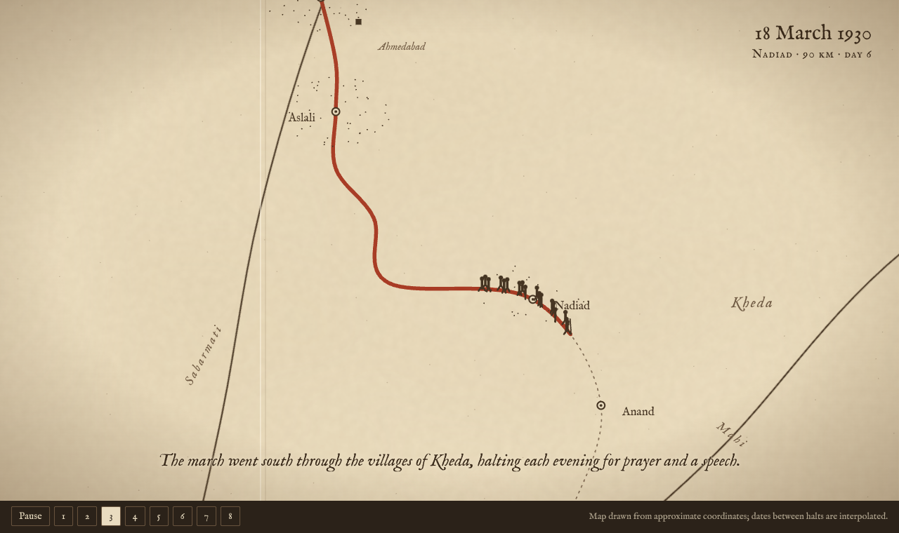
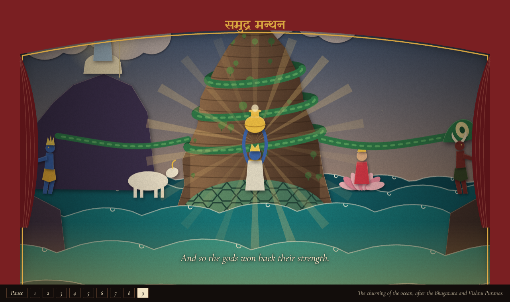

# Motifs

Each motif is a visual language with one governing rule, and the narration script drives every one. Each line of the script sets the clock (about 2.5 words a second) and a target state for the stage. The camera, light and cast ease toward that state while the line is read.

| Motif | Rule | Prototype |
|---|---|---|
| Diorama | A museum tabletop model, shot in chapters | [Panipat 1526](../panipat/) |
| Campaign map | Ink on an old paper map; the route draws itself as it's narrated | [The Salt March, 1930](salt-march/) |
| Paper theatre | Layers of cut card in depth behind a fixed proscenium | [Samudra Manthan](samudra-manthan/) |
| Scan | Measurement reveals the past, layer by layer | not yet |
| Data sculpture | Numbers as physical stacks | not yet |
| Patent drawing | Numbered line drawings and hatching | not yet |

Both prototypes are single HTML files with no dependencies beyond Google Fonts.

