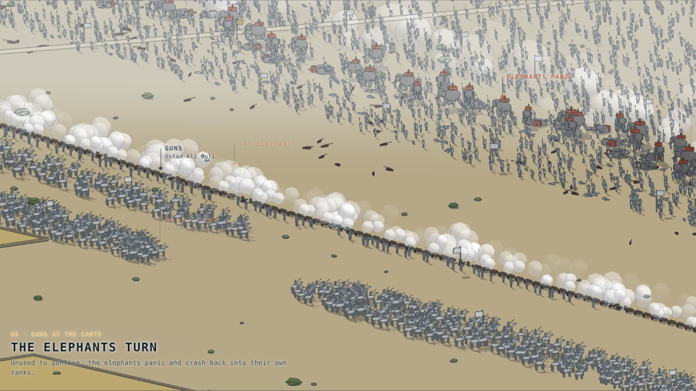
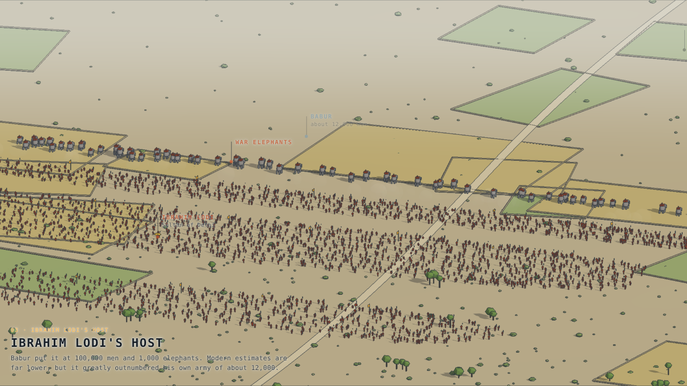
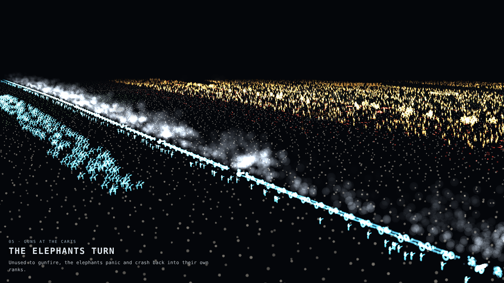

# Panipat 1526

The First Battle of Panipat, 21 April 1526 (Babur against Ibrahim Lodi), as an animated 3D figure in two styles. Both run the same battle data and the same 88-second film in nine chapters.

- **Diorama:** https://nikitph.github.io/vande-bharat-figure/panipat/ uses two-tone shading, ink outlines and shadows, in the style of the train figure, with six themes.
- **Point cloud:** https://nikitph.github.io/vande-bharat-figure/panipat/points.html is about two million glowing points on black.



| Ibrahim Lodi's host, in morning haze | Point-cloud version |
| --- | --- |
|  |  |

## The film

1. The plain of Panipat
2. Babur's position: the town on his right, a ditch and felled trees on his left, and the cart line (araba) across the front
3. Ibrahim Lodi's host, with the war elephants
4. The advance
5. Guns at the carts, and the elephants turn
6. Tulughma: the flanking parties ride round both wings
7. Encircled
8. The sultan falls
9. Aftermath

Drag to turn, scroll to zoom, right-drag to pan, double-click to return to the film camera. You can switch labels, captions and movement arrows on and off.

## How it works

The battle is data in `src/11-scene.js`: units with their size, type, side and keyframed moves (position, facing, frontage, depth, pace, disorder, losses), plus chapters that move the camera, volleys, ground arrows and labels. Every figure is placed on the GPU from its unit's state, so thousands of soldiers, horses and elephants move with no per-figure work in JavaScript.

```
src/10-core.js    point-cloud helpers and ground height
src/11-scene.js   the battle: units, moves, chapters, volleys, arrows, labels
src/12-build.js   point-cloud figures, terrain, carts, smoke, arrows, the fallen
src/13-main.js    point-cloud renderer, camera, overlay, <panipat-battle>
src/21-solid.js   diorama figures, terrain slab, town, carts, smoke, arrows, the fallen
src/22-main.js    diorama renderer with ink lines, themes, overlay, <panipat-diorama>
build.py          builds panipat-diorama.js and panipat-points.js
```

The diorama reuses the train's material code (`../src/01-core.js`) and theme table, so run `python3 build.py` from this folder after changing either.

The visual rules behind the diorama are collected in [CRAFT.md](CRAFT.md).

## Accuracy

This is an illustration of the standard account, not a reconstruction.

- **Troop figures:** numbers, deployments and commanders were written from memory and have not been checked against sources.
- **Elephants:** Babur's own figure of 100,000 men and 1,000 elephants is quoted as his claim.
- **Scale:** figures stand for many men each. In the diorama they are also drawn about twice life size so they read at battlefield scale.
